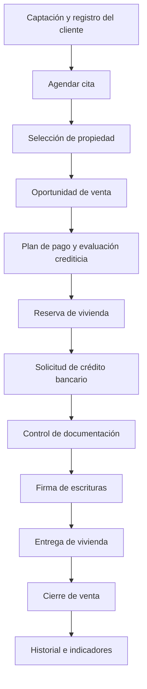
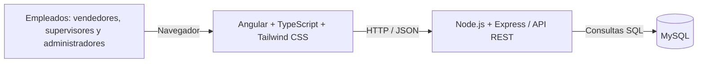
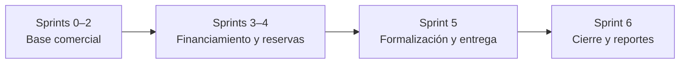

# 🏡 SIGVI — Sistema Integral de Gestión de Ventas Inmobiliarias

**Plataforma web para organizar y dar seguimiento al proceso comercial de una inmobiliaria, desde la captación de un cliente hasta el cierre de la venta y la entrega de su vivienda.**

> **Estado del proyecto:** prototipo académico funcional — desarrollo por sprints 0 al 6. Los módulos comerciales y de reportes cuentan con pruebas de aceptación realizadas durante el desarrollo. El acceso por cuenta de empleado y los paneles por rol se incorporaron como mejora final; su despliegue y pruebas deben verificarse en el entorno de entrega. Los permisos específicos por rol y el endurecimiento de seguridad quedan pendientes.


[Problema](#-problema-que-resuelve) · [Funcionalidades](#-funcionalidades) · [Funcionamiento](#-flujo-del-proceso-inmobiliario) · [Arquitectura](#-arquitectura) · [Sprints](#-desarrollo-por-sprints) · [Instalación](#-instalación-y-ejecución) · [Pruebas](#-validación-funcional) · [Mejoras](#-mejoras-pendientes)

---

## 📌 Descripción general

**SIGVI** centraliza la información comercial necesaria para gestionar clientes, propiedades, citas, oportunidades, evaluaciones crediticias, reservas, solicitudes bancarias, control documental, firmas, entregas y ventas finalizadas.

El proyecto está orientado a una empresa inmobiliaria con **varios vendedores**, **supervisores** y **administradores** que participan en distintas etapas de la operación. La solución facilita la consulta del estado de cada trámite y ofrece reportes para apoyar el seguimiento de la actividad comercial.

### 🎯 Problema que resuelve

En un proceso inmobiliario, la información puede quedar distribuida entre diferentes registros, archivos o comunicaciones. Esto dificulta conocer qué cliente está interesado en una vivienda, qué documentación falta, qué reservas continúan activas y cuáles ventas ya finalizaron.

SIGVI reúne ese seguimiento en un único sistema, con el objetivo de **mejorar la organización, la trazabilidad del proceso y la disponibilidad de información**. Estos son beneficios esperados del diseño; el proyecto no afirma haber medido reducciones de costos o tiempos en una empresa real.

## ✅ Funcionalidades

| Área | Funcionalidad disponible |
|---|---|
| Acceso | Inicio de sesión con cuentas existentes, identificación del rol y cierre de sesión; sin registro público |
| Paneles | Página inicial diferenciada para vendedor, supervisor y administrador |
| Clientes | Registro y consulta de información de clientes |
| Citas | Programación y seguimiento de citas comerciales |
| Propiedades | Consulta y gestión del catálogo inmobiliario |
| Oportunidades | Seguimiento del interés del cliente y del estado de una posible venta |
| Financiamiento | Registro de opciones y planes de pago; evaluación crediticia |
| Reservas | Registro, confirmación y seguimiento de reservas de viviendas |
| Solicitudes de crédito | Registro de solicitudes bancarias, seguimiento y actualización de estado |
| Documentación | Control de DPI, carta laboral, estados de cuenta y documentos adicionales mediante estados administrativos |
| Formalización | Registro de firma de escrituras una vez cumplidas las condiciones definidas en el sistema |
| Entregas | Registro administrativo de la entrega de una vivienda |
| Cierre de ventas | Registro de venta completada, cambio de propiedad a vendida y oportunidad a ganada |
| Reportes | Indicadores generales, ventas en proceso, créditos pendientes, reservas activas, historial y exportación CSV |

> **Alcance del acceso:** los paneles presentan distintas opciones según el rol, pero **no equivalen a autorización efectiva por operación**. La aplicación requiere controles de permisos en la API antes de trabajar con información real.

## 🔁 Flujo del proceso inmobiliario



**Ejemplo:** un vendedor registra a un cliente interesado en una casa, agenda la visita y registra la oportunidad comercial. Conforme avanza el trámite, se controla la evaluación financiera, la reserva y la documentación. Una vez registrada la formalización y la entrega, se completa la venta y la propiedad pasa a estado **vendida**.

## 👥 Usuarios considerados

| Rol | Uso previsto del sistema |
|---|---|
| **Vendedor** | Registrar clientes, organizar citas y dar seguimiento a oportunidades, reservas y trámites |
| **Supervisor** | Consultar el avance comercial, supervisar operaciones y revisar reportes |
| **Administrador** | Consultar el sistema de forma general y, en una futura etapa, administrar cuentas y configuraciones |

Los permisos definitivos y el proceso de creación de cuentas deben acordarse con la empresa. No se incluye un formulario público de registro.

## 🧩 Arquitectura

La solución utiliza una **arquitectura web cliente-servidor**. Angular presenta la interfaz; Express expone los endpoints REST y aplica la lógica del negocio; MySQL conserva los datos.



### 🛠️ Tecnologías

| Capa | Tecnología | Uso |
|---|---|---|
| Frontend | Angular, TypeScript | Componentes, formularios, rutas y consumo HTTP |
| Diseño | Tailwind CSS | Interfaz adaptable y estilos |
| Backend | Node.js, Express | Servicios y validaciones de negocio |
| Datos | MySQL, `mysql2/promise` | Persistencia y consultas SQL |
| Autenticación | `bcryptjs`, `jsonwebtoken` | Comprobación de contraseñas y token de sesión |
| Herramientas | Git, GitHub, Postman o Thunder Client | Versionado y pruebas manuales de API |

## 🗂️ Organización del código

Estructura **orientativa** de los módulos principales desarrollados. Los nombres exactos de carpetas pueden variar según la organización local del proyecto.

```text
Proyecto_IS_2026/
├── backend/
│   └── src/
│       ├── config/          # Conexión MySQL y configuración de Express
│       ├── routes/          # Endpoints de clientes, reservas, créditos, cierres...
│       └── server.js        # Inicio del servidor
├── [carpeta-angular]/
│   └── src/app/
│       ├── dashboard/       # Módulos funcionales
│       ├── components/      # Login, panel y componentes reutilizables
│       ├── services/        # Consumo de API y autenticación
│       ├── guards/          # Protección de navegación en Angular
│       └── app.routes.ts    # Rutas del frontend
└── README.md
```

## 🏃 Desarrollo por sprints

El trabajo se organizó de forma incremental, con objetivos funcionales y validaciones por módulo.

| Sprint | Enfoque principal |
|---|---|
| **Sprint 0** | Preparación de Angular, Node.js, Express y conexión con MySQL |
| **Sprint 1** | Clientes y funcionalidades comerciales iniciales |
| **Sprint 2** | Propiedades, citas y oportunidades |
| **Sprint 3** | Seguimiento de ventas y opciones de financiamiento |
| **Sprint 4** | Evaluaciones crediticias y reservas |
| **Sprint 5** | Solicitudes de crédito, documentos, firma y entrega |
| **Sprint 6** | Cierre de ventas, estado de propiedades e indicadores y reportes |

### Hitos de negocio



## 🚀 Instalación y ejecución

### Requisitos previos

- Node.js y npm instalados.
- MySQL disponible (por ejemplo, mediante XAMPP local).
- Angular CLI compatible con la versión definida en `package.json`.
- Respaldo o script SQL del esquema de la base de datos.

### 1. Clonar el repositorio

```bash
git clone https://github.com/Angel-D2004/Proyecto_IS_2026.git
cd Proyecto_IS_2026
```

### 2. Preparar MySQL

1. Iniciar MySQL.
2. Crear una base de datos para SIGVI.
3. Importar el respaldo `.sql` proporcionado con la entrega, si existe.
4. Configurar las credenciales de conexión en el backend según `src/config/db.js`.

> No se incluye una contraseña de base de datos en este README. No subir respaldos que contengan datos privados o credenciales reales.

### 3. Configurar e iniciar el backend

Desde la carpeta `backend`:

```bash
npm install
node src/server.js
```

Configurar las variables de entorno utilizadas por la conexión MySQL y la variable `JWT_SECRET`, requerida por el inicio de sesión. Los nombres precisos de las variables de base de datos deben consultarse en `backend/src/config/db.js`.

**API local:** `http://localhost:3000`

### 4. Iniciar Angular

Abrir una segunda terminal en la carpeta que contenga `angular.json`:

```bash
npm install
npx ng serve
```

**Aplicación web:** `http://localhost:4200`

### 5. Iniciar sesión

El acceso se realiza desde `/login` utilizando cuentas creadas previamente en la base de datos. No existe registro público. El entorno de entrega debe contar con usuarios de prueba activos, contraseñas configuradas mediante hash y roles `vendedor`, `supervisor` o `administrador`.

## 🧪 Validación funcional

Durante el desarrollo se realizaron pruebas de aceptación de endpoints y pantallas. Entre los casos validados se encuentran:

- Registrar y actualizar solicitudes de crédito, consultar estados y agregar seguimientos.
- Registrar documentación y validar las transiciones de estado.
- Evitar firmas sin crédito aprobado o documentos obligatorios verificados.
- Evitar entregas sin firma o con fecha anterior a la formalización.
- Impedir el cierre duplicado de ventas y actualizar la propiedad a **vendida**.
- Consultar indicadores, historial de ventas y exportar un reporte CSV.

**Registro de la validación reciente:** Sprint 5 — Solicitudes de Crédito: **24/24**; Documentación: **22/24** (dos pruebas de registro desde Angular pendientes de confirmar en el registro compartido); Firma y Entrega: **24/24**; Sprint 6 — Cierre y Reportes: **12/12**. La autenticación agregada al final requiere comprobación en el entorno de entrega.

> Estas cifras corresponden a las pruebas manuales reportadas durante el desarrollo y no implican una suite automatizada ni una auditoría de seguridad.

## 📊 Reportes e indicadores

El panel de finalización permite visualizar:

- Total de clientes y propiedades.
- Propiedades vendidas y ventas completadas.
- Oportunidades comerciales activas.
- Reservas activas y créditos pendientes.
- Valor registrado de ventas cerradas.
- Historial de ventas y agrupación mensual.
- Exportación del historial a formato CSV.

Los importes de cierre reflejan **valores de las propiedades registrados en el sistema**, no necesariamente ingresos efectivamente cobrados.

## 🔐 Alcance y mejoras pendientes

SIGVI es un **prototipo académico**. Antes de un uso con datos reales se requiere:

1. Implementar permisos por rol en **cada endpoint del backend**, no solo ocultar opciones en el panel.
2. Incorporar administración de cuentas, altas/bajas y restablecimiento seguro de contraseñas según las políticas de la empresa.
3. Agregar auditoría de operaciones sensibles y revisiones de seguridad.
4. Proteger el almacenamiento y el tratamiento de documentos personales y financieros.
5. Completar pruebas automatizadas, manejo robusto de errores y despliegue seguro.
6. Confirmar las reglas de negocio que correspondan a supervisores, vendedores, administradores y procesos de contado.

> El registro administrativo de firmas y entregas **no sustituye una escritura legal, el acto notarial ni la validación auténtica de documentos**.

## 📚 Documentación del proyecto

El análisis y la planificación del proyecto contemplan los siguientes entregables, cuando estén incluidos en el repositorio:

- `Epics.md` — épicas y alcance del sistema.
- `UserStoryMapping.md` — organización de historias de usuario.
- `SprintPlanning.md` — objetivos, priorización y distribución por sprints.

Verificar la ubicación de estos archivos y ajustar sus enlaces al publicarlos.

---

**SIGVI · Sistema Integral de Gestión de Ventas Inmobiliarias**  
*Proyecto académico de desarrollo de software · Guatemala · 2026*
